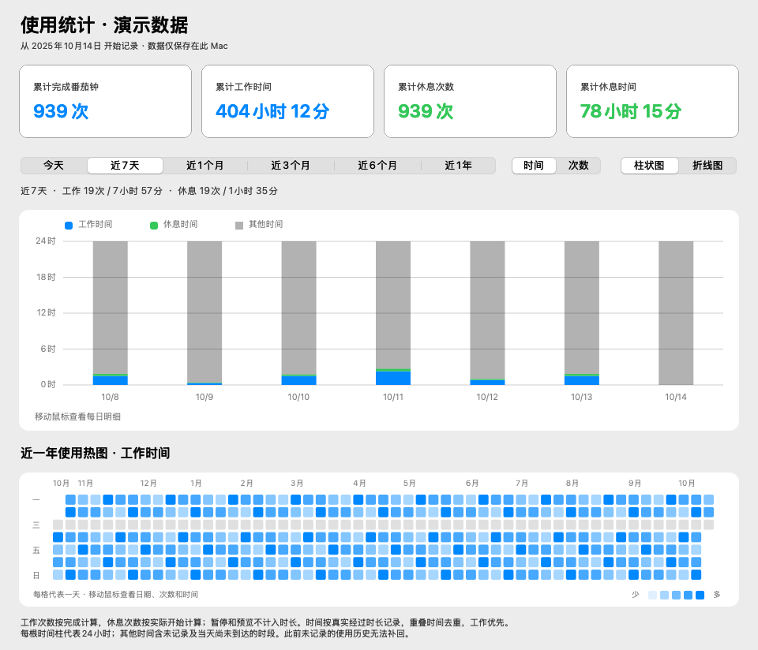
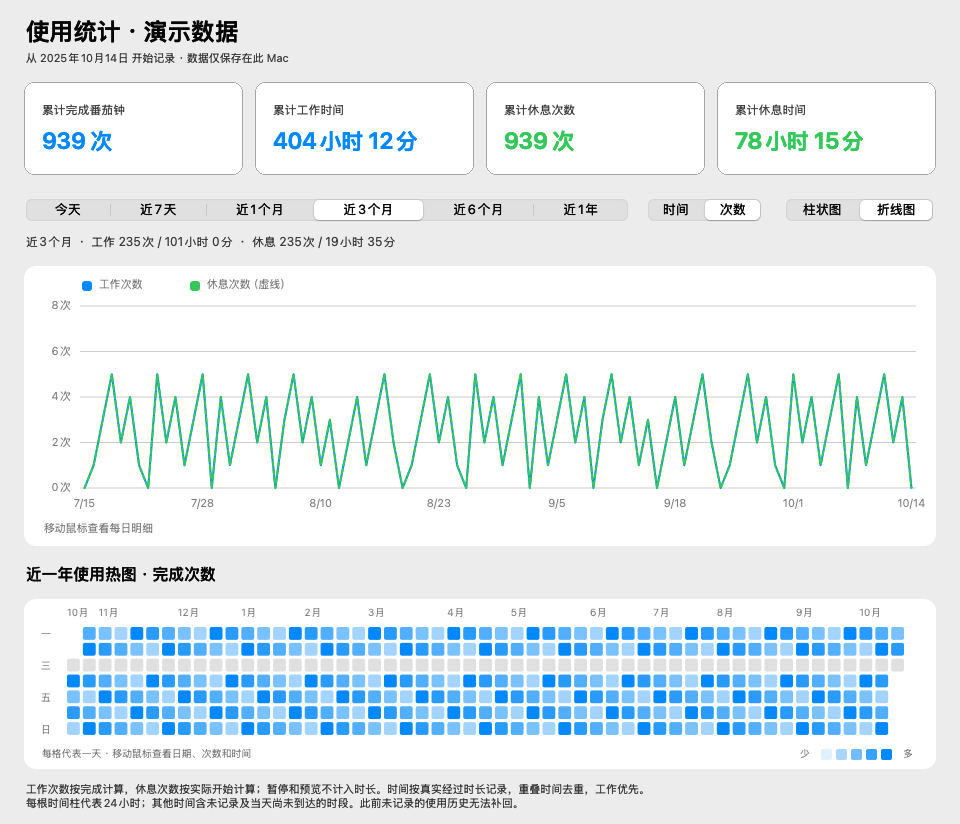

# 使用统计

从“视图 → 使用统计…”打开原生统计窗口。可在计时运行期间查看，窗口每 5 秒刷新；关闭统计窗口不会停止番茄钟。

## 统计口径

- **工作次数**：完成倒计时的番茄钟次数。暂停与继续属于同一轮；重置、关闭或退出前未完成的轮次不增加次数。
- **工作时间**：实际经过的计时时长，暂停期间不计入。提前重置或关闭时，已经工作的时间仍保存；倍速模式按真实时长统计。
- **休息次数**：完成专注后，实际开始的休息次数。手动结束也算一次；排队中尚未开始的休息及预览场景不计入。
- **休息时间**：实际休息时长，手动结束按实际时间记录，自然结束不超过所选休息时长。关闭中央数字、使用“无”场景不影响实际休息记录。
- 多个计时器的完成次数分别记录，时长按实际时间轴去重；工作与休息重叠时优先归为工作。
- 跨午夜的时长拆分到对应日期；工作次数归入完成日期，休息次数归入开始日期。

## 趋势图

支持今天、近 7 天、近 1 个月、近 3 个月、近 6 个月和近 1 年。月、年按本地日历计算，包含闰日；所有周期以天为单位显示。

| 指标 | 柱状图 | 折线图 |
| --- | --- | --- |
| 时间 | 每根柱代表一天 24 小时，蓝色工作、绿色休息、灰色其他时间堆叠显示 | 蓝色实线显示工作时间，绿色虚线显示休息时间 |
| 次数 | 每天以蓝、绿两根并列柱显示工作和休息次数 | 蓝色实线与绿色虚线分别显示工作和休息次数 |

“其他时间”包含暂停、未记录的时间以及当天尚未到达的时间。遇到夏令时导致的 23/25 小时日期，时间柱按当日长度归一化为 24 小时，明细和折线仍显示真实时长。

移动鼠标到趋势图可查看日期、工作/休息次数与时长。

## 使用热图

近一年每天一个方格，行表示周一到周日，列表示周。选择“时间”时按每日工作时长着色，选择“次数”时按每日完成次数着色；颜色越深，使用量越高。移动鼠标到方格可查看每日明细。

## 本地保存

数据文件位于：

```text
~/Library/Application Support/Minutes2/usage-statistics.json
```

统计从此功能启用后开始记录，无法补回此前没有记录的历史。数据仅保存在当前 Mac，不随 Git 仓库上传。

记录在开始、暂停、结束、重置及退出时保存，运行中每 15 秒保存检查点。正常退出会保存当前实际时长；异常结束后恢复至最近的检查点，不将应用关闭期间计入工作时间。如果文件无法读取，会保留原文件并在统计窗口提示，而不会覆盖已有文件。

以下图片均为**演示数据**，不代表用户的真实使用历史：




